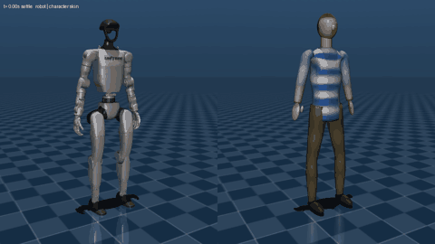

# mujoco-characters (`mjchar`)

Rigged humanoid characters (Meshy.ai exports, or any skinned humanoid GLB) in MuJoCo.

This is **level 1** of the Meshy → MuJoCo plan: the character is a visual
`<skin>` on a Menagerie robot (Unitree G1). The robot keeps its validated
physics, actuators and any policy trained for it, and the character's mesh
deforms with the robot's bodies. The same GLB reader and bone mapping are the
start of level 2 (build an MJCF body from the rig and drive it with Meshy
animation clips) and level 3 (motion-imitation policies per character).



The character above is the **synthetic test rig** in `src/mjchar/testrig.py`,
not a Meshy export. No real Meshy file was available when this was written. See
[Using a real Meshy export](#using-a-real-meshy-export).

More evidence in `docs/evidence/`: an MP4 of the full 21 s routine, a contact
sheet (robot | robot + skin | skin only at eight moments) and a close-up still.

## Run it from a cvcpkg prefix

Everything comes from cvcpkg packages: Python, numpy, MuJoCo, the Menagerie
models, the viewer's GLFW/OpenGL bindings, Pillow for images and ffmpeg for MP4.

```bash
cvcpkg install python312 numpy-cp312 mujoco mujoco-core-cp312 mujoco-menagerie glfw glfw-cp312 pyopengl-cp312 pillow-cp312 ffmpeg-cli --prefix ./deps
```

On Windows, `mujoco-core-cp312` (`import mujoco`) is not in the catalog yet:
its populate is still running (cy-pca/cvcpkg#606). Until it is published, use
a prefix that already has it, or build the recipe locally. This repo was
tested with one built from the cy-pca/cvcpkg#595 recipe. Linux and macOS
builds are published.

Then, from the repo root (Git Bash shown; in PowerShell use
`$env:PYTHONPATH = "src"` and `deps\python.exe`):

```bash
export PYTHONPATH=src
deps/python.exe -m mjchar testrig out/testrig.glb                  # or use your Meshy GLB
deps/python.exe -m mjchar inspect out/testrig.glb                  # skeleton and bone mapping
deps/python.exe -m mjchar skin out/testrig.glb -o out/g1_testrig   # writes out/g1_testrig/unitree_g1_testrig.xml
deps/python.exe examples/demo_g1.py out/g1_testrig/unitree_g1_testrig.xml --viewer
deps/python.exe examples/demo_g1.py out/g1_testrig/unitree_g1_testrig.xml --render out/evidence
```

`mjchar skin` finds Menagerie in the running interpreter's prefix
(`share/mujoco-menagerie`), in `$CVCPKG_PREFIX`, or at `--menagerie` /
`$MUJOCO_MENAGERIE`. The output folder is self-contained: the XML (the full G1
scene with the skin added through `mujoco.MjSpec`), the G1 meshes copied from
Menagerie with its BSD-3 licence, the character texture as PNG, and a `.json`
sidecar with the conversion report and the reference pose.

In the viewer the robot's visual geoms (group 2) start hidden. Press `2` to
show the robot under the skin. `--show-robot` starts with it visible.

Tests: `deps/python.exe -m unittest discover -s tests` (11 tests, about 4 s).
They check the bone aliases, that the centimetre and metre rigs load the same,
and that MuJoCo's own skinning (`MjvScene.skinvert`) reproduces the bind mesh at
the reference pose and matches the reference implementation at the stand pose.

## How it works

1. **Read the GLB** (`gltf.py`, pure numpy). Rebuild the mesh in its bind pose
   in world space from the skin's joint transforms and inverse bind matrices.
   Units come out in metres whatever the file uses (Meshy's default rig is in
   centimetres under a 0.01-scaled node). Convert glTF axes (Y up, facing +Z) to
   MuJoCo's (Z up, facing +X), and turn the character to face +X using its
   left/right bones.
2. **Map bone names** (`bones.py`) to canonical Mixamo names. Bones that don't
   map (fingers, twist and end bones) are bound through their nearest mapped
   ancestor.
3. **Pose the robot like the character** (`retarget.solve_reference_pose`).
   A small least-squares IK per limb makes the G1's upper arm, forearm, thigh
   and shin parallel to the character's (T- or A-pose), keeping the feet flat.
4. **Re-proportion the character** (`retarget.fit_character`). Scale it
   uniformly to the G1's leg length, then apply per-bone affine maps blended by
   the skin weights. Each limb segment is stretched along its axis so the
   character's shoulder, elbow, wrist, hip, knee and ankle land on the G1's.
   The trunk is mapped from hip centre to shoulder centre, with the width
   scaled to the robot's hips at the bottom and shoulders at the top. Head,
   hands and feet stay rigid (feet squashed so the sole meets the G1's sole).
   `--no-fit` skips this step (uniform scale only).
5. **Bind** (`retarget.bind_skin`). Merge the character's bone weights onto G1
   bodies. Each body's world pose in the reference configuration becomes its
   `bindpos`/`bindquat`. MuJoCo then skins every frame with
   `v = X_body(t) · X_body(bind)⁻¹ · v_bind`.

## Bone map (G1)

| Canonical (Mixamo) | Meshy `meshyrig` | G1 body driving it | G1 joint the bone's head lands on |
|---|---|---|---|
| Hips | Hips | `pelvis` | hip centre (trunk map) |
| Spine, Spine1, Spine2 | Spine, Spine01, Spine02 | `torso_link` | trunk map |
| Neck, Head | neck, Head | `torso_link` (G1 has no neck joint) | rigid on the trunk |
| L/R Shoulder (clavicle) | LeftShoulder | `torso_link` | trunk map |
| L/R Arm | LeftArm | `left_shoulder_yaw_link` | `left_shoulder_roll_link` origin |
| L/R ForeArm | LeftForeArm | `left_elbow_link` → `left_wrist_roll_link` (weight split along the forearm for twist) | `left_elbow_link` origin |
| L/R Hand (+ fingers) | LeftHand | `left_wrist_yaw_link` | `left_wrist_pitch_link` origin |
| L/R UpLeg | LeftUpLeg | `left_hip_yaw_link` | `left_hip_pitch_link` origin |
| L/R Leg | LeftLeg | `left_knee_link` | `left_knee_link` origin |
| L/R Foot, ToeBase | LeftFoot, LeftToeBase | `left_ankle_roll_link` | `left_ankle_pitch_link` origin |

Right side mirrors left. The table lives in `src/mjchar/robots.py`; a new
robot is a new `RobotProfile` there.

Name conventions recognised (`bones.canonical_name`):

- Mixamo (`mixamorig:Hips`, also `mixamorig1:` / `mixamorig_` and `Armature|` prefixes).
- Meshy's default `meshyrig` (`Spine01`, `Spine02`, `neck`, `head_end`, `headfront`).
- UE5 Mannequin (`pelvis`, `spine_01..05`, `thigh_l`, `calf_l`, `ball_l`,
  `clavicle_l`, `upperarm_l`, `lowerarm_l`; twist bones ignored).
- Unity Humanoid (`LeftUpperLeg`, `LeftLowerArm`, `Chest`, `UpperChest`, `LeftToes`).

Anything else: `--bone-map map.json` with `{"source bone": "CanonicalName"}`.

## Limits

- **G1 only so far.** Booster T1 (Apache-2.0 in Menagerie) needs its own
  profile in `robots.py`: body names, landmarks, IK joints.
- **Proportions follow the robot.** The G1's arms are short for a human of
  its height. The test rig's upper arm shrinks to 0.85× and its forearm to
  0.71×, legs change by less than 6%. A character much bulkier than the G1 will
  have the robot poke through if both are drawn. Use skin-only view.
- **No fingers, toes, neck, face or jaw motion.** The G1 (29-DoF Menagerie
  model) has rubber hands, rigid feet and a head fixed to the torso, so those
  bones ride on the wrist, ankle and torso.
- **Linear blend skinning.** MuJoCo skins are LBS. Large twists pinch (the
  forearm weight split spreads wrist roll along the forearm) and deep bends
  lose volume. Meshy's auto-weights are untested here.
- **One texture.** The base-colour texture of the first material is used
  (JPEG/WebP converted to PNG with Pillow). Normal, metallic and roughness
  maps and vertex colours are dropped. Extra materials share the first texture.
- **GLB features not supported:** Draco and meshopt compression, sparse
  accessors, morph targets. Animation clips are parsed (`gltf.Animation`) but
  not used until level 2.
- **The demo has no learned policy.** It uses the G1's own position servos on
  a scripted routine (squat, wave, waist twist, march in place) plus an
  ankle-strategy balance term that keeps the centre of mass over the feet.
  The squat, wave and twist are steady. The march is quasi-static: the feet
  lift only 2-3 cm and the feet drift up to 7 cm over the eight steps.
  A trained G1 policy (Playground or mjlab) drops in by replacing
  `Controller.__call__` and keeps the same skin.

## Using a real Meshy export

Development so far used only the synthetic rig. To check the tool on a real
character:

1. In Meshy, rig a humanoid (T- or A-pose, textured, facing +Z) and download
   the **rigged GLB**. Either the default skeleton or the Mixamo template
   works. The API equivalent is `POST /openapi/v1/rigging`, then
   `rigged_character_glb_url`.
2. Run `python -m mjchar inspect character.glb`. Check that every core bone
   maps (missing ones are listed) and note the names. Meshy's docs say the
   default `meshyrig` skeleton has 24 bones with Mixamo-like names. The 24
   names assumed here are inferred from those docs and need confirming
   against a real file. A third-party test reported non-standard spine and
   clavicle names, so expect to add aliases or a `--bone-map`.
3. Run `python -m mjchar skin character.glb -o out/meshy`, then the demo.

**Licensing of Meshy assets: check Joe's plan before using a character
commercially.** As of 2026-11, Meshy's pricing docs say free-plan outputs are
CC BY 4.0: commercial use is allowed with attribution, and Meshy suggests a
credit line in the readme or product page. Pro and higher plans give a private
licence with full commercial use. Models generated while on a paid plan keep
those rights after a downgrade. Nothing here assumes which plan applies.

## Next (level 2)

`mjchar.gltf` already reads the skeleton, weights, inverse bind matrices and
animation clips. Level 2 turns the rig into an MJCF body:

- a capsule per bone fitted to the vertices it dominates;
- hinge or ball joints from the bone frames, with limits from the clips' range of motion;
- position actuators;
- the skin bound with the same `bind_skin`;
- Meshy's walk/run clips replayed as kinematic targets or reference motion.

Level 3 trains tracking policies per character on those clips (mjlab).

## Layout

```
src/mjchar/gltf.py      GLB reader/writer (numpy only)
src/mjchar/bones.py     bone-name normalisation and canonical humanoid table
src/mjchar/robots.py    robot profiles (G1), Menagerie discovery
src/mjchar/retarget.py  bind pose, robot IK, re-proportioning, skin binding
src/mjchar/mjcf.py      MjSpec assembly and output folder
src/mjchar/testrig.py   synthetic Mixamo/meshyrig-named test character
examples/demo_g1.py     PD stand + scripted routine; viewer, MP4/GIF/contact sheet
tests/test_mjchar.py    unit and integration tests
```
